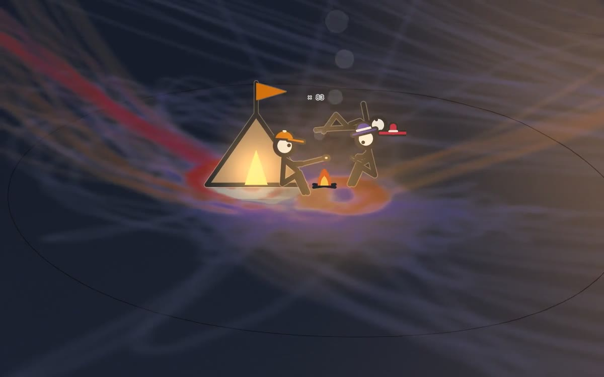

# An Atlas of Loss Surfaces

**[Open the atlas →](https://matteohe.com/atlas-of-loss-surfaces/)**

Forty loss surfaces in raised relief, explored by twelve optimizers. Each plate is a seeded two-parameter surface
`L(θ₁, θ₂)` built to show one phenomenon from the optimization literature. Particles cross it taking real optimizer
steps, and leave ink.

The plates are grouped in eight chapters:

1. **Landforms**: basins of attraction, saddles, plateaus, ravines, cliffs, sharp and flat minima
2. **Step size and noise**: stability and catapults, the edge of stability, implicit gradient regularization, noise as
   temperature, the shape and the tails of the noise, label noise
3. **Optimizers**: momentum, Adam and sign descent, weight decay and scale invariance, Newton's method, sharpness-aware
   minimization, weight averaging
4. **Trajectories**: saddle to saddle, warmup, the river valley
5. **Solutions**: mode connectivity, forks in the road, symmetry and re-basin, singular minima and the learning
   coefficient
6. **Proving grounds**: Rosenbrock, Himmelblau, Rastrigin, Ackley, the six-hump camel, and a sheet you sculpt yourself
7. **Where there is no bottom**: two players on one sheet, the pull of softmax, the road to infinity
8. **After pretraining**: likelihood displacement, entropy collapse, RL's razor, the safety basin

The optimizers are gradient descent and SGD, heavy ball, Nesterov, Adam, RMSprop, sign descent, Lion, SAM, Newton,
saddle-free Newton and schedule-free SGD, plus plate-specific update rules for games and policy gradients.

## How it is built

Every sheet is an analytic function, and every number printed on a plate is computed from the surface it is printed
on: critical points by Newton's method, curvatures from the Hessian, and rates, escape times and equilibria measured
from the particles. Each plate card states the finding, cites the papers it comes from, says how settled the result
is, and gives experiments to try, with predictions that were checked in the page. The about panel (**I**) explains
what a two-parameter map cannot show.

Come close and the particles become stick men. Their gait, poses and reactions are read from the optimizer's state:
they scratch their heads at saddles, cartwheel when catapulted, and sit round a fire at rest points, posed by how sharp
the minimum is for their step size.

## Using it

- Drag to turn the model, right-drag to pan, scroll to approach, click to release a cohort.
- **↑ ↓** move between plates; **E** opens the plate card; **I** the about panel, with every key.
- The toolbar along the bottom (on a phone, at the top of the plate card) holds the modes: walk with a stick man
  (**W**), cross-section (**X**), flood (**D**), plan view (**T**), dusk (**N**) and watch a few stick men up close
  (**O**).
- **P** parameters and seed, **S** capture the frame as a PNG, **H** hide the interface.

It runs in any browser with WebGL2. It is plain HTML, JavaScript and WebGL2, with no libraries and no build step. To
run it locally, open `index.html`, or serve the folder with `python3 -m http.server`.

## How the code is laid out

- `index.html`: the page, its metadata and three scripts.
- `js/atlas.js`: the atlas, one script. Sections open with a `// ----` banner, in this order:
  - the surfaces: seeded noise, the loss `L(θ₁, θ₂)`, the height grid, critical points (grid scan, Newton
    refinement, Hessian classification), cross-sections and the disconnectivity scaffold;
  - the optimizers and the forty plates. Each plate is one object, `PLATES.push({ … })`, holding its sheet builder,
    names, experiments, card text and figure. Plates sit in blocks marked `// <<chN … // chN>>`; a plate's chapter
    is its `ch` field, and the reading order is the `ORDER` list;
  - the WebGL renderer (relief, ink, baked shadows, and the stick men, drawn as signed-distance figures in a
    fragment shader) and the printed layer (names, contours, margin);
  - the particles: a struct-of-arrays simulation that steps every optimizer on the same stochastic gradient;
  - the camera, the pointer, the overlay (labels, the hover instrument, campfires), the plate card, plate building
    and the main loop.
- `js/frame.js`, `js/gl.js`, `css/frame.css`: a small runtime shared with other pieces by the same author (title,
  about and parameter panels, seeds, capture, WebGL helpers).
- `css/atlas.css`: the atlas's own interface.

Some internal names predate the current wording: `TRIBES` are the optimizers, the `pilgrim…` functions draw the
stick men, and the project was first called Pilgrims.

## Credits and licence

By hematteo, made with Claude (Anthropic). The results shown belong to the papers cited on each plate.

Code: [MIT](LICENSE). Text, figures and images: [CC BY 4.0](https://creativecommons.org/licenses/by/4.0/).
